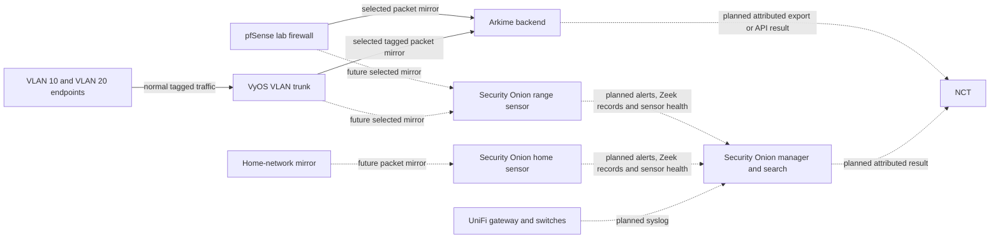

# Range observability: what connects to what

This guide explains where range evidence comes from, what each system adds, and how
to trace a problem from the network to the screen. It describes the intended test
range and labels anything that has not yet passed live acceptance.

Exact test counts, retained-file locations, checksums, rollback references and known
lab risks are preserved in
[Range observability validation record](RANGE_OBSERVABILITY_VALIDATION_RECORD.md).

## The four evidence paths

| Path | What enters it | What it provides | Current state |
|---|---|---|---|
| Packet path | A deliberately mirrored network link | Arkime sessions and packet-backed Security Onion detections | Arkime is proven on the lab pfSense LAN and on bounded VLAN 10 and VLAN 20 tests. Security Onion is not yet accepted. |
| Log path | UniFi syslog messages | Device, administrator, firewall and network-event records that may not be visible in packet traffic | Planned. The exact UniFi settings and Security Onion destination have not yet been verified. |
| NCT evidence path | Selected Arkime exports, Security Onion results and device collections | Retained evidence with scope, time, sensor and source attribution | Planned for Phase 6. The current live tests do not connect this lab to the deployed Work Range NCT. |
| Management path | Administrator access to Proxmox, Arkime, Security Onion and network devices | Configuration, health checks and troubleshooting | Present in the lab. It must remain separate from passive capture traffic. |

## Intended layout

The diagram follows evidence toward the tools, with one normal-traffic line from the
test endpoints into the VyOS trunk. Solid evidence lines have been exercised for the
stated Arkime tests. Dotted lines remain planned until their acceptance checks pass.

## Security Onion role and interface plan

The range uses one supported Security Onion `ManagerSearch` node and two supported
Security Onion `Sensor` nodes. The manager/search node provides the analyst interface
and indexed event storage. It does not sniff mirrored traffic. Each sensor has one
numbered management interface and separate unnumbered capture interfaces.

| Node | Management | Capture | Purpose |
|---|---|---|---|
| Manager/Search | `172.22.70.10/24` on `vmbr5` | None | Security Onion Console, coordination and indexed search data |
| Range sensor | `172.22.70.20/24` on `vmbr5` | `vmbr3` and `vmbr4` only | Range packet analysis for the approved mirror points |
| Home sensor | `172.22.70.21/24` on `vmbr5` | `vmbr2` only | Home-mirror packet analysis |

All three nodes use gateway `172.22.70.1` and DNS `10.0.0.53` on the management
network. Capture interfaces must remain without an IP address, DNS setting or default
route. Before installation, each planned management address must be checked for a
conflict. The manager's intended web address is `https://172.22.70.10`.

The provisional lab allocations are 8 vCPU, 24 GiB RAM and 400 GiB disk for the
manager/search node, and 8 vCPU, 16 GiB RAM and 900 GiB disk for each sensor. These
meet or exceed the published Security Onion 2.4 minimums for their roles, but acceptance still
requires measured CPU, memory, ingest rate and retention under the lab's actual
traffic. Thin-provisioned disk size is not proof that physical capacity exists.

### Arkime separation decision

Arkime remains a separate passive-evidence system on VM 118. Additional Arkime
services will not be installed inside the Security Onion sensors. Security Onion
already performs its supported sensor duties with Zeek, Suricata and local packet
retention; installing another packet platform on the same sensor would compete for
CPU, memory and disk while making evidence ownership harder to explain.

When both products need the same traffic, the range may deliberately fan out the
approved mirror to the Security Onion sensor and VM 118. Each observation retains its
own sensor, source, time and coverage labels. NCT may correlate those observations but
must not add their counts together as though they were independent connections. This
separation replaces the earlier shorthand description of "Arkime on the sensors."

## What each system is for

### Arkime

Arkime organizes retained packet sessions. It is useful when an analyst needs to
see who communicated, when it happened, which ports and protocols were involved,
and, when retained bytes are available, the packet evidence behind the session.
The current lab proof includes tagged VLAN 10 and VLAN 20 sessions.

### Security Onion sensor

A sensor watches a selected mirrored link. It turns packet traffic into searchable
Zeek records and Suricata detections, then reports those results and its own health
to the manager. A sensor can only describe traffic that actually reaches its capture
interface. A running sensor is not proof of complete coverage.

### Security Onion manager and search

The manager and search services provide the central place to find sensor results and
received logs. Acceptance requires more than a login page: a known packet event and a
known UniFi test message must both be findable with the correct time and source.

### UniFi syslog

UniFi syslog is a log feed, not a packet mirror. It can add device, administrator,
firewall and network-event context. The exact events depend on the installed UniFi
software and enabled logging. NCT and Security Onion must preserve the UniFi device
identity and reception time instead of presenting a log as packet evidence.

### NCT

NCT is the correlation and triage layer. It should retain the source system, sensor,
observation point, collection window, Network Scope and coverage limits for every
passive result. NCT must not merge two sightings merely because Arkime and Security
Onion observed the same connection.

## Preventing duplicate or misleading evidence

The same connection may be visible at more than one mirror point. Every accepted
observation point therefore needs a stable name and a written coverage statement.
Arkime and Security Onion records remain separate source observations. NCT may show
that they support the same analyst conclusion, but it must not add their counts
together as if they were different connections unless that interpretation is proven.

Use these initial observation-point names:

| Name | Intended coverage | Status |
|---|---|---|
| `range-arkime-pfsense-lan` | Selected pfSense lab-LAN traffic | Bounded path proven; the current mirror is temporary and reboot-volatile. |
| `range-arkime-vyos-trunk` | Selected tagged VLAN 10 and VLAN 20 traffic | Bounded temporary test proven; the temporary adapter and mirror were removed after testing. |
| `range-so-sensor` | Selected range traffic for Zeek and Suricata | Not yet accepted. |
| `home-so-sensor` | Selected traffic from the approved home-network mirror | Not yet accepted. |
| `unifi-syslog` | Logs sent by named UniFi devices | Not yet configured or accepted. |

## Security Onion and UniFi acceptance checklist

Do not mark Security Onion operational until all applicable checks pass:

1. Record the manager and sensor versions, VM resources, interfaces, storage and time
   synchronization.
2. Confirm the manager and each intended sensor start cleanly and remain healthy after
   a controlled restart.
3. Confirm every capture interface is unnumbered, has no default route, and receives
   only the intended mirror traffic.
4. Generate a small known packet test for each approved observation point and find its
   Zeek record or Suricata event in Security Onion with the expected sensor and time.
5. Record what each sensor cannot see. Keep management traffic and unrelated networks
   outside the mirror.
6. Configure one named UniFi device to send syslog to the approved Security Onion
   receiver. Generate or identify a harmless known event and find it with the correct
   device identity and time.
7. Restart the relevant receiver and confirm that new events continue to arrive without
   silently duplicating the earlier test.
8. Measure storage growth and set a retention limit before sustained capture or logging.
9. Record exact searches, timestamps, sensor names and limitations as retained
   acceptance evidence.

## Troubleshooting in order

Follow the evidence path from left to right. Do not skip directly to the user interface.

| Step | Check | A failure usually means |
|---|---|---|
| 1. Source | The expected packet or UniFi event actually occurred. | There is no evidence to receive. |
| 2. Forwarding | The mirror or syslog destination is the intended one. | Traffic was sent elsewhere or not copied. |
| 3. Sensor interface | Packet counters or receiver counters increase on the correct interface. | Bridge, VLAN, firewall or destination settings are wrong. |
| 4. Service | Arkime capture or the Security Onion sensor/receiver is healthy. | The data arrived at the VM but was not processed. |
| 5. Storage | New session, event or log records are written and disk space is safe. | Processing or storage failed after receipt. |
| 6. Search | The exact test is findable by time, address, VLAN, device and sensor. | Search timing, parsing or field mapping is wrong. |
| 7. NCT — future Phase 6 check | The retained result shows its source, sensor, time, scope and coverage. | NCT ingestion or attribution is incomplete. |

## Kubernetes transition boundary

The Kubernetes-capable NCT deployment is a side-by-side candidate. It must use its
own persistent storage and pass the Kubernetes acceptance gates before replacing the
current standalone Python/Docker NCT VM. The existing VM remains available as an
application rollback candidate during that trial. Recovering after the candidate has
written new evidence or changed its schema also requires compatible retained data or
a verified restore. Security Onion and Arkime remain separate evidence systems;
moving NCT to Kubernetes does not move or replace their sensors.

## Current proven boundary

As of 2026-10-20, the lab has proven Arkime capture and search for a bounded pfSense
LAN test and a separate bounded tagged VLAN 10/VLAN 20 test. The latter produced 38
combined host sessions, including 21 sessions found with `vlan == 10` and 17 found
with `vlan == 20`. The temporary VLAN mirror and adapter were removed, the original
pfSense-LAN capture path was restored, and management reachability was rechecked.

Security Onion manager/search, the range sensor, the home sensor, UniFi syslog,
persistent mirror rules, long-duration stability and NCT passive ingestion remain open
work. This document is a connection and acceptance guide; it is not a Range-readiness
claim.
